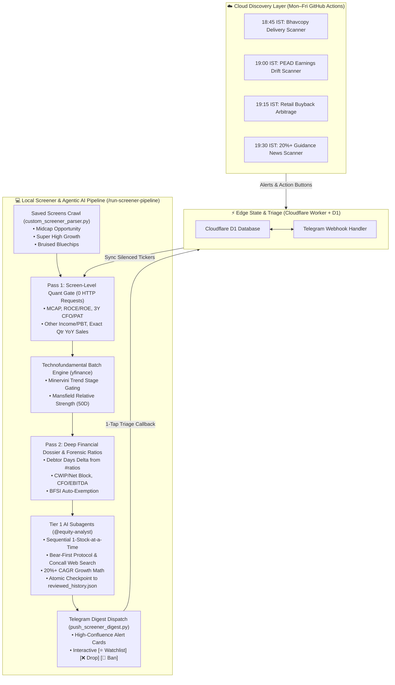

# 🦅 AlphaMinter: Autonomous Institutional Equity Discovery & Signal Suite

**Version:** 2.6.0 (Institutional Agentic Edition)  
**Target Markets:** Indian Equities (NSE & BSE)  
**Core Philosophy:** Asymmetric Risk/Reward, Quantitative Proof First, Strict Bear-First Debiasing, $\ge 20\%$ CAGR Institutional Hurdle.

AlphaMinter is a hybrid autonomous equity research system combining **cloud-native scheduled scanners** (GitHub Actions + Cloudflare Workers + D1) with a **local multi-pass AI analyst pipeline** (Antigravity + Screener.in + yfinance + Telegram). It is designed to identify, rigorously audit, and surface high-probability swing, PEAD, bruised bluechip, and growth compounder setups with zero maintenance and zero recurring API costs.

---

## 🏛️ System Architecture



---

## ⚡ Core Signal Engines

### 1. Cloud-Native Discovery Layer (GitHub Actions)
Runs automatically Monday through Friday on GitHub Actions infrastructure at zero server cost:

| Engine | Schedule (IST) | Target | Core Guardrails & Rules |
| :--- | :---: | :--- | :--- |
| **Bhavcopy Delivery Scanner** | `18:45` | NSE Bhavcopy & Delivery | Strict Operating Equity Guard (excludes ETFs, REITs, InvITs; protects `GOLDIAM`/`GOLDTECH`), holiday validation (`DATE1 == today`), and delivery turnover floor ($\ge ₹5\text{ Cr}$). |
| **PEAD Earnings Drift Scanner** | `19:00` | BSE Corporate Announcements | Real earnings acceleration ($\text{PAT} \ge 30\%$, $\text{Revenue} \ge 15\%$, $\text{OPM} \ge +150\text{ bps}$), reaction session confirmation ($\ge +4\%$ gain, volume $\ge 3\times$ 20D avg, delivery $\ge 50\%$), above 50 EMA. |
| **Buyback Arbitrage Calculator** | `19:15` | BSE Corporate Actions | Strictly evaluates `TENDER_OFFER` buybacks (excludes open-market), safe retail sizing at $\lfloor 195,000 / \text{CMP} \rfloor$ (below ₹2L SEBI threshold), T-2 trading day execution cutoff alert. |
| **20%+ Guidance Scanner** | `19:30` | Exchange Corporate Filings | Gemini 3.5 Flash Lite parsing management commentary, dynamic fiscal year detection, and paragraph-level token pre-filtering. |

---

### 2. Local Multi-Pass AI Screener Pipeline (`/run-screener-pipeline`)

Executed locally via Antigravity, blending zero-overhead deterministic Python preparation with single-stock institutional AI audits:

#### **Stage 1: Zero-Quota Quantitative Preparation (`prepare_screener_batch.py`)**
1. **Screen Crawl & 6-Hour Cache**: Crawls custom Screener.in screens with 2.0s jittered pacing and automatic session cookie management.
2. **Pass 1 — Instant Screen-Level Quant Gate (0 Network Requests)**:
   - Evaluates Market Cap floor ($\ge ₹5,000\text{ Cr}$), ROCE ($\ge 10–12\%$) or ROE ($\ge 10–12\%$ for BFSI).
   - **`Operating cash flow 3years / Net profit`**: Flags `FORENSIC_LOW_CFO` upfront if $< 0\times$ or $< 0.60\times$.
   - **`Other income last year / Profit before tax last year`**: Flags `FORENSIC_OTHER_INC` upfront if $> 0.20$ ($>20\%$ non-core).
   - **`Sales latest quarter / Sales preceding year quarter`**: Direct quarterly top-line expansion ratio $( \text{Ratio} - 1.0 ) \times 100\%$.
   - **Multi-Year Cushion**: 1 weak quarter is not penalized if 3Y/5Y profit CAGR $\ge 15\%$ or sales CAGR $\ge 12\%$.
3. **Technofundamental Trend Gating (`yfinance`)**:
   - Calculates Mark Minervini Stage: `STAGE_2_UPTREND` ($\text{CMP} > \text{EMA 50} > \text{EMA 150} > \text{EMA 200}$ with rising 200 EMA), `STAGE_1_BASE`, or `STAGE_4_DOWNTREND`.
   - **Screen-Conditional Policy**: Stage 4 downtrend strictly rejected on momentum/growth screens; permitted as Stage 1 base on `Bruised Bluechips`.
   - Mansfield Relative Strength (50D) vs Nifty 500 benchmark.
   - Robust NSE $\rightarrow$ BSE (`.NS` $\rightarrow$ `.BO`) and Nifty 500 $\rightarrow$ Nifty 50 (`^CRSLDX` $\rightarrow$ `^NSEI`) fallbacks.
4. **Pass 2 — Deep Financial Dossier & Forensic Ratios**:
   - Parses static Screener `#ratios` table: `Debtor Days` jump ($>15\text{ days}$ vs 3Y average), `Working Capital Days`, and `Inventory Days`.
   - `CWIP / Net Block` ratio ($>0.30$ for $2+$ consecutive years flagged as `FORENSIC_CWIP_TRAP`).
   - **BFSI Auto-Exemption**: Automatically exempts Banks and NBFCs from manufacturing cash-flow and working capital metrics.
   - **Multi-Flag Drop**: Any candidate triggering $\ge 2$ independent forensic or negative flags is dropped before AI analysis.
   - Emits single-stock active batch files (`active_batch_1.json`, etc.).

#### **Stage 2: Sequential Institutional AI Subagent (`@equity-analyst`)**
Runs sequentially (1 stock at a time) to guarantee atomic checkpointing of `data/reviewed_history.json`:
* **Bear-First Protocol**: The agent is forced to search for reasons to *kill* the trade first (valuation multiple compression, forensic traps, working capital bloat, cyclical sector headwinds).
* **Targeted Web Concall & Guidance Audit**: Searches brokerages and transcripts for management Q&A tone, evasions, and forward commitments.
* **$\ge 20\%$ CAGR Growth Math**: Tests if the setup satisfies the hurdle across one of 4 defined alpha pathways:
  1. *P/E Re-rating on Quality Compounder*
  2. *Earnings Compounding with Multiple Derating Stress-Test*
  3. *Capex Inflection & Operating Leverage Turnaround*
  4. *Market Beta & Cyclical Proxy Recovery*
* **Outputs**: Structured verdict (`STRONG_BUY_WATCH`, `ACCUMULATE_ON_DIP`, `HOLD_WATCH`, `REJECT`), conviction score (1–10), and 3 pre-committed **Thesis Invalidation Triggers (Kill-Switches)**.

#### **Stage 3: Dispatch & Interactive Mobile Triage (`push_screener_digest.py`)**
Pushes approved candidates (`STRONG_BUY_WATCH` and `ACCUMULATE_ON_DIP`) to Telegram with complete metrics, return math, guidance takeaways, and 1-tap interactive inline buttons:
* `[⭐ Watchlist]` — Promotes candidate to high-conviction tracking in Cloudflare D1.
* `[❌ Drop 30D]` — Silences candidate across all screeners and bots for 30 days (auto-expiring in D1).
* `[🚫 Permaban]` — Permanently blacklists the ticker from future discovery.

---

## 🎯 The 4 Alpha Pathways (Return Math Framework)

AlphaMinter will NOT recommend a stock simply because it is a quality bluechip. Every qualifying pick must show mathematical probability of achieving a **$\ge 20\%$ annualized return (3Y CAGR)**:

$$\text{Total Expected CAGR} \approx \text{Forward EPS CAGR} + \Delta\text{P/E Multiple CAGR} + \text{Dividend Yield}$$

```text
┌───────────────────────────────────────────────────────────────────────────────┐
│                           THE 4 ALPHA PATHWAYS                                │
├────────────────────────────────┬──────────────────────────────────────────────┤
│ 1. P/E Re-rating Compounder    │ Multi-year compounder trading at 25-40%      │
│                                │ valuation discount vs 5Y median.             │
│                                │ (e.g., 12% EPS + 8% P/E mean-reversion = 20%)│
├────────────────────────────────┼──────────────────────────────────────────────┤
│ 2. Earnings Compounding        │ High-growth reinvestor (25%+ Sales/PAT CAGR) │
│                                │ capable of beating multiple derating drag.   │
│                                │ (e.g., 28% EPS - 6% P/E compression = 22%)   │
├────────────────────────────────┼──────────────────────────────────────────────┤
│ 3. Capex Inflection            │ Multi-year non-earning CWIP commissioning    │
│                                │ into revenue, triggering asset-turnover surge│
│                                │ and operating margin expansion.              │
├────────────────────────────────┼──────────────────────────────────────────────┤
│ 4. Cyclical / Value Recovery   │ Cyclical trough / beaten-down sector proxy   │
│                                │ positioned for margin normalization.         │
└────────────────────────────────┴──────────────────────────────────────────────┘
```

---

## 🧠 Brainstorming Matrix: What Else to Add?

Use this categorized expansion roadmap to brainstorm and prioritize high-impact additions to the AlphaMinter suite:

```text
┌────────────────────────────────────────────────────────────────────────────────────────┐
│                        ALPHAMINTER FEATURE EXPANSION MATRIX                            │
└────────────────────────────────────────────────────────────────────────────────────────┘
```

### 1. Smart Money & Institutional Footprint Tracking
* [ ] **Daily Bulk & Block Deals Scanner (`19:45 IST`)**:
  * Ingest official NSE/BSE daily bulk and block deal files.
  * Filter for high-conviction marquee institutional buyers (e.g., Nalanda, ChrysCapital, Ashish Kacholia, Vijay Kedia, mutual fund institutional blocks).
  * Tag candidates in `prepare_screener_batch.py` with `SMART_MONEY_BUY` or `INSTITUTIONAL_EXIT`.
* [ ] **Promoter SAST & PIT (Insider Trading) Ingestion**:
  * Ingest SEBI Regulation 7(2) PIT disclosures (Promoter and KMP open-market purchases/sales).
  * Trigger automated alerts when promoters initiate open-market creeping acquisitions ($\ge 0.5\%$ equity over 30 days) during a price correction.
* [ ] **Shareholding Drift Score**:
  * Parse quarterly shareholding patterns to track institutional confluence: $\Delta\text{FII} + \Delta\text{DII} > 0$ while retail count drops (institutional absorption).

---

### 2. Sector Regime & Relative Strength Alignment
* [ ] **Nifty Sectoral 200 EMA Guard**:
  * Automatically map a candidate's Screener sector to its corresponding Nifty Sectoral Index (`NIFTY AUTO`, `NIFTY IT`, `NIFTY PHARMA`, `NIFTY METAL`, `NIFTY FMCG`, etc.).
  * Label the macro regime:
    * **`SECTOR_TAILWIND`**: Sector Index is above its 200 EMA and outperforming Nifty 50.
    * **`SECTOR_HEADWIND`**: Sector Index is below its 200 EMA (requires extra margin of safety).
* [ ] **Sector Breadth Indicator**:
  * Calculate the percentage of stocks in the candidate's industry trading above their 50-day EMA. Entering stocks in sectors with $>70\%$ breadth significantly boosts win rates.

---

### 3. Advanced Technical & Price-Action Quality Gates
* [ ] **Volatility Contraction Pattern (VCP) Detector**:
  * Implement Mark Minervini’s VCP algorithm: search for successive contraction contractions ($20\% \rightarrow 10\% \rightarrow 4\%$) accompanied by drying volume before breakout.
* [ ] **Anchored Volume-Weighted Average Price (AVWAP)**:
  * Compute AVWAP anchored from key catalytic events:
    1. *Earnings Announcement Date* (PEAD AVWAP).
    2. *52-Week Low* (Base anchor).
    3. *Major Union Budget / Election Date*.
  * Stocks trading above their Post-Earnings AVWAP represent institutional accumulation support.
* [ ] **Delivery Spike Confluence on Moving Average Tests**:
  * Identify when a `Bruised Bluechip` touches its 200-day EMA or 50-day EMA with delivery volume $\ge 2.5\times$ 20-day average (smart-money accumulation pocket).

---

### 4. Concall & Qualitative NLP Intelligence
* [ ] **Management Evasion & Sentiment Scoring**:
  * In the concall audit, score management responses on a 1–5 Directness Scale:
    * Direct quantitative target (capex amount, quarter of commissioning, margin guidance band) $= 5/5$.
    * Deflection, vague qualitative optimism ("environment is challenging but we remain positive") $= 1/5$.
* [ ] **Brokerage Consensus Target Drift (Trendlyne / Refinitiv)**:
  * Pull forward consensus EPS revisions over the past 90 days.
  * Stocks with positive EPS upgrades during a price dip offer high asymmetric re-rating upside.
* [ ] **Tier 2 Deep-Dive Swarm (`@deep-dive-analyst`)**:
  * Triggered strictly when you tap `[⭐ Watchlist]` in Telegram.
  * Spawns a 3-agent adversarial debate:
    1. **Bull Agent**: Models the optimistic expansion case and TAM runway.
    2. **Bear Agent**: Rigorously audits forensic accounting, debt maturities, and competitive threats.
    3. **Portfolio Manager Agent**: Synthesizes the debate, determines Kelly position size, and sets pre-committed invalidation triggers.

---

### 5. Automated Risk, Sizing & Post-Mortem Feedback Loop (`/learn`)
* [ ] **Kelly Position Sizing Calculator**:
  * Automatically calculate suggested portfolio allocation percentage based on conviction score (8–10), stop-loss distance, and sector exposure cap ($<25\%$).
* [ ] **Automated Thesis Invalidation Watchdog**:
  * Daily scheduled check against the 3 pre-committed kill-switches (e.g. quarterly OPM drops below 10%, quarterly volume growth decelerates $<5\%$).
  * Alerts Telegram immediately if an invalidation trigger fires: *"⚠️ THESIS BREACH: [SYMBOL] reported OPM of 8.2% vs kill-switch threshold of 10.0%."*
* [ ] **Autonomous Forward-Drift Post-Mortem (`/learn`)**:
  * Automated weekly job tracking benchmarked returns at **T+30, T+60, and T+90 days** vs Nifty 500 for all reviewed stocks.
  * Automatically triggers an LLM post-mortem on any recommendation experiencing $>15\%$ drawdown to determine whether the failure was an analytical error, unforeseen macro shock, or governance violation, dynamically updating screening rules.

---

## 🛠️ Repository Layout

```text
AlphaMinter/
├── .agents/
│   ├── agents/
│   │   ├── equity-analyst.md          # 1-stock Bear-First institutional subagent
│   │   └── deep-dive-analyst.md       # Tier-2 adversarial 3-agent swarm (Watchlist)
│   └── skills/
│       └── run-screener-pipeline/     # Pipeline orchestration skill
├── .github/
│   └── workflows/                     # Mon–Fri automated discovery workflows
├── cloudflare_worker/
│   └── worker.js                      # Edge webhook handler for Telegram callbacks
├── config/
│   └── screens.json                   # Screener URLs, rubrics, and quant thresholds
├── data/
│   ├── cache/                         # 6H cache for screens and dossiers
│   ├── prepared_queues/               # Auto-generated batches for subagents
│   └── reviewed_history.json          # 7-day atomic review cooldown ledger
├── logs/
│   ├── screener_audit_YYYY-MM-DD.jsonl # Machine-readable audit trails
│   └── screener_audit_YYYY-MM-DD.md   # Full institutional dossiers
└── src/
    ├── arbitrage/                     # Buyback arbitrage engine
    ├── local/
    │   ├── custom_screener_parser.py  # Zero-bloat Screener.in static parser
    │   ├── prepare_screener_batch.py  # Stage 1 quant & forensic gate
    │   └── push_screener_digest.py    # Telegram card formatter & dispatcher
    ├── notifications/                 # Telegram Bot API client
    ├── scanners/                      # Bhavcopy, PEAD, Guidance scanners
    └── storage/                       # Cloudflare D1 state client
```

---

## 🚀 Quick Setup & Usage

### 1. Environment Configuration
Create a `.env` file in the root directory:
```env
TELEGRAM_BOT_TOKEN="your_bot_token"
TELEGRAM_CHAT_ID="your_chat_id"
CLOUDFLARE_WORKER_URL="https://your-worker.workers.dev"
GEMINI_API_KEY="your_gemini_key"
SCREENER_EMAIL="dummy_screener_account@example.com"
SCREENER_PASSWORD="dummy_password"
```

### 2. Running the AI Screener Pipeline
Trigger the full data preparation and quant gate:
```bash
# Prepare candidate queues (runs in ~20-30 seconds)
python src/local/prepare_screener_batch.py

# Invalidate screen cache and pull updated columns live
python src/local/prepare_screener_batch.py --refresh-screens

# Dispatch reviewed candidates to Telegram
python src/local/push_screener_digest.py
```

Or execute end-to-end inside Antigravity with:
```text
/run-screener-pipeline
```

---

## 📜 License
Private proprietary trading and investment research system. Built with Antigravity.
